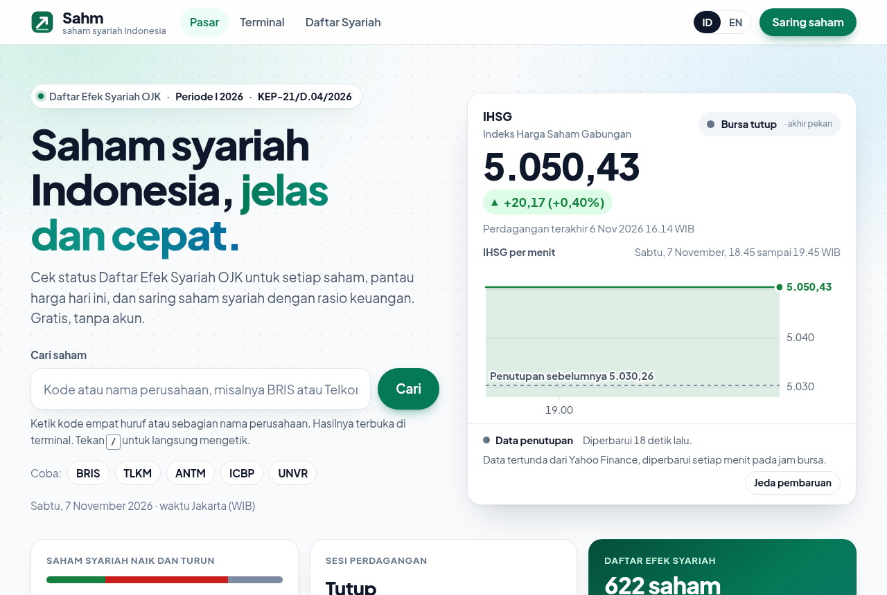
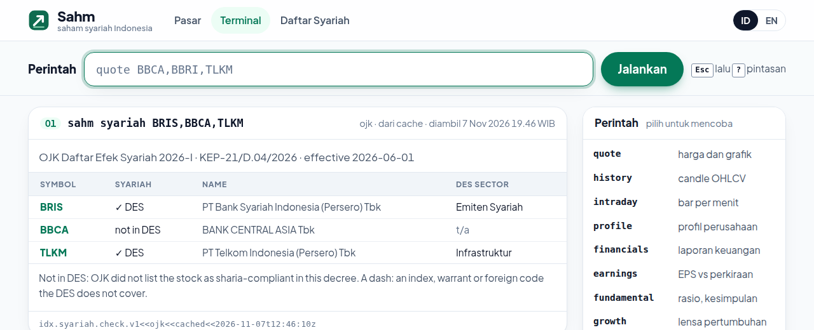

<p align="center">
  
</p>

<h1 align="center">Sahm</h1>

<p align="center">
  Saham syariah Indonesia menurut Daftar Efek Syariah OJK: status syariah, harga, pergerakan dan penyaring.<br>
  Gratis, tanpa akun, dari data publik.
</p>

<p align="center">
  <a href="https://sahm.sahm-web.workers.dev"><b>sahm.sahm-web.workers.dev</b></a> ·
  <a href="https://sahm.sahm-web.workers.dev/terminal">Terminal</a> ·
  <a href="https://sahm.sahm-web.workers.dev/en/">English</a> ·
  <a href="LICENSE">Lisensi MIT</a>
</p>

<p align="center">
  <a href="https://sahm.sahm-web.workers.dev"></a>
</p>

> سهم (*sahm*) dalam bahasa Arab berarti "saham", sekaligus "anak panah".

## Fitur

- **Status syariah untuk setiap saham.** Setiap kode saham ditandai `✓ DES` bila tercantum dalam Daftar Efek Syariah (DES) OJK yang berlaku, atau `not in DES` bila tidak. Datanya diambil apa adanya dari keputusan OJK; Sahm tidak menilai kehalalan sendiri.
- **Halaman pasar khusus saham syariah.** IHSG per menit, jumlah saham syariah yang naik dan turun, 16 saham syariah terbesar, serta saham syariah yang paling naik, paling turun dan paling ramai.
- **Penyaring saham syariah.** Status syariah bisa digabung dengan rasio keuangan: P/E, P/B, dividen, ROE, margin, utang, kapitalisasi pasar, imbal hasil 1 minggu sampai 1 tahun.
- **Terminal di peramban.** Harga dan grafik, fundamental, teknikal, dividen, berita, broker, pemegang saham di atas 1 %, dan lain-lain, semuanya dari mesin [idx](https://github.com/fzn0x/idx).
- **Bahasa Indonesia dan Inggris**, tema terang dan gelap, nyaman di ponsel.
- **Apa adanya.** Setiap angka menyebut sumber dan waktunya. Bila sumber tidak memberi nilai, Sahm menulis `t/a`, tidak menebak.

## Coba di terminal

<p align="center">
  
</p>

Buka [terminal](https://sahm.sahm-web.workers.dev/terminal) lalu ketik:

| Perintah | Hasil |
| --- | --- |
| `syariah BRIS,BBCA,TLKM` | status DES setiap kode, beserta sektornya |
| `syariah --sector energi` | daftar saham syariah satu sektor |
| `syariah --search bank` | cari di DES menurut kode atau nama |
| `screen --preset syariah` | semua saham syariah, dari kapitalisasi terbesar |
| `screen syariah=ya,pe<15,div>3 --sort div` | saham syariah murah dengan dividen di atas 3 % |
| `screen syariah=tidak` | kebalikannya: saham di luar DES |
| `quote TLKM` | harga dan grafik, dengan kolom Syariah |
| `help` | semua perintah |

## API

Semua jawaban berbentuk amplop JSON yang sama dengan idx (`schema`, `provider`, `fetched_at`, `cached`, `stale`, `warnings`, `data`).

| Endpoint | Isi |
| --- | --- |
| `GET /api/syariah?symbols=BRIS,BBCA` | status DES per kode (`true`, `false`, atau `null` untuk indeks, waran dan kode asing) |
| `GET /api/syariah?sector=energi&search=…` | isi DES, disaring menurut sektor dan kata kunci |
| `GET /api/market?syariah=1` | IHSG, naik dan turun, saham terbesar dan penggerak, hanya saham DES |
| `GET /api/screen?filter=syariah%3Dya,pe%3C15` | penyaring; kunci `syariah` menerima `ya` atau `tidak` |
| `GET /api/quote?symbols=TLKM` | harga, dengan field `syariah` |

```sh
curl -s "https://sahm.sahm-web.workers.dev/api/syariah?symbols=BRIS,BBCA" | jq '.data.checks'
```

Endpoint lain (riwayat harga, fundamental, teknikal, dividen, berita, broker, kepemilikan) mengikuti idx; lihat [panduan API](https://sahm.sahm-web.workers.dev/docs/).

## Data dan sumber

| Data | Sumber |
| --- | --- |
| Daftar Efek Syariah | OJK, [KEP-21/D.04/2026](https://ojk.go.id/id/kanal/syariah/data-dan-statistik/daftar-efek-syariah/Pages/Daftar-Efek-Syariah-KEP21D042026.aspx), Periode I 2026, berlaku sejak 1 Juni 2026, 622 saham |
| Harga, rasio, laporan keuangan | Yahoo Finance, tertunda sebagaimana diterbitkan |
| Lainnya | MSN Money, Indo Premier (IPOT), register KSEI, Kontan dan CNBC Indonesia, sesuai yang disebut di setiap hasil |

DES disimpan di [`data/syariah.csv`](data/syariah.csv), dengan nomor keputusan, tanggal berlaku dan SHA-256 PDF sumbernya di [`data/syariah.meta.json`](data/syariah.meta.json). OJK menyaring dengan kriteria POJK 35/2017, antara lain utang berbasis bunga paling banyak 45 % dari aset dan pendapatan tidak halal paling banyak 10 % dari pendapatan.

### Memperbarui DES

OJK menerbitkan DES baru setiap Mei dan November (berlaku 1 Juni dan 1 Desember), dan bisa mengubahnya di antara keduanya.

1. Unduh PDF lampiran keputusan dari [halaman DES OJK](https://ojk.go.id/id/kanal/syariah/data-dan-statistik/daftar-efek-syariah/default.aspx) ke `data/raw/` (folder ini di-gitignore).
2. Ubah PDF menjadi teks lalu CSV:
   ```sh
   npm install --no-save pdfjs-dist@4.10.38   # sekali, untuk extract.mjs
   node scripts/des/extract.mjs data/raw/<lampiran>.pdf /tmp/des.txt
   node scripts/des/parse.mjs /tmp/des.txt data/syariah.csv
   ```
   `parse.mjs` mencetak jumlah baris, apakah nomor urutnya lengkap, jumlah kode unik dan baris yang tidak terbaca; cocokkan dengan jumlah saham di keputusan OJK.
3. Perbarui `data/syariah.meta.json` (periode, nomor keputusan, tanggal, jumlah, SHA-256), lalu bangun ulang JSON-nya (ditolak bila jumlah baris tidak sama dengan `count`) dan jalankan test:
   ```sh
   node web/scripts/syariah.mjs
   node --test web/test/*.mjs
   ```

## Menjalankan sendiri

Sahm adalah Cloudflare Worker (HTML, CSS dan JavaScript tanpa framework) dengan database D1 yang diisi cron setiap menit pada jam bursa. Butuh Node 22 dan akun Cloudflare gratis.

```sh
git clone https://github.com/idsoke/sahm.git
cd sahm/web
npm install
node --test test/*.mjs                     # semua test, tanpa jaringan
```

**Lokal:** buat `web/.dev.vars` (di-gitignore) berisi `PUBLIC_HOST=localhost`, lalu:

```sh
npx wrangler d1 migrations apply sahm --local
npx wrangler dev                           # http://localhost:8787
```

Papan harga terisi saat cron berjalan, atau seketika lewat `/api/refresh?token=…` bila `.dev.vars` juga berisi `ADMIN_TOKEN=…`.

**Deploy ke akun Cloudflare Anda:**

```sh
npx wrangler login
npx wrangler d1 create sahm                # tempel database_id-nya ke web/wrangler.toml
npx wrangler d1 migrations apply sahm --remote
npx wrangler deploy                        # mencetak https://sahm.<subdomain>.workers.dev
node scripts/set-host.mjs sahm.<subdomain>.workers.dev   # semua berkas ke host itu
node scripts/og.mjs                        # buat ulang kartu share (butuh Chrome)
npx wrangler deploy
```

Rincian ada di [`web/README.md`](web/README.md).

## Struktur

```
web/                 aplikasi Sahm (Cloudflare Worker)
  public/            halaman (index, terminal, 404; salinan Inggris di en/), styles.css, skrip peramban
  src/               Worker: api.js (endpoint), syariah.js (DES), analysis.js (penyaring), penyedia data
  scripts/           syariah.mjs (DES ke JSON), set-host.mjs, og.mjs (kartu share), docs.mjs (/docs)
  test/              node --test, tanpa jaringan
data/                syariah.csv + syariah.meta.json (DES), universe.csv, holidays.csv, brokers.csv
scripts/des/         PDF DES ke CSV
src/, docs/          CLI dan server MCP idx (Rust) beserta dokumentasinya, dari proyek asal
```

## Batasan

- Status syariah sepenuhnya mengikuti DES OJK yang dibundel. Sahm tidak menghitung ulang rasio syariah, dan status bisa tertinggal bila OJK mengubah DES di luar jadwal sampai data diperbarui.
- Harga tertunda sekitar 10 menit atau lebih, sesuai sumbernya.
- **Bukan fatwa dan bukan saran investasi.** Sahm adalah alat bantu riset. Untuk pertanyaan fikih, rujuk Dewan Syariah Nasional MUI dan ahlinya; keputusan investasi tetap di tangan Anda. Sahm tidak berafiliasi dengan OJK, PT Bursa Efek Indonesia, KSEI, Yahoo atau Microsoft.

## Kredit dan lisensi

Sahm dikembangkan dari [idx](https://github.com/fzn0x/idx), perangkat sumber terbuka untuk data pasar saham Indonesia (CLI, server MCP dan terminal web) karya Midori Research dan kontributor idx. Mesin data, penyedia, analisis dan terminal Sahm berasal dari sana. README asli idx disimpan di [`IDX-README.md`](IDX-README.md).

Dirilis dengan [lisensi MIT](LICENSE), dengan pemberitahuan hak cipta idx tetap utuh.
